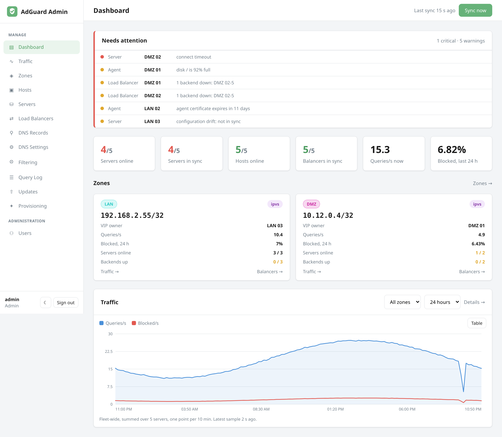
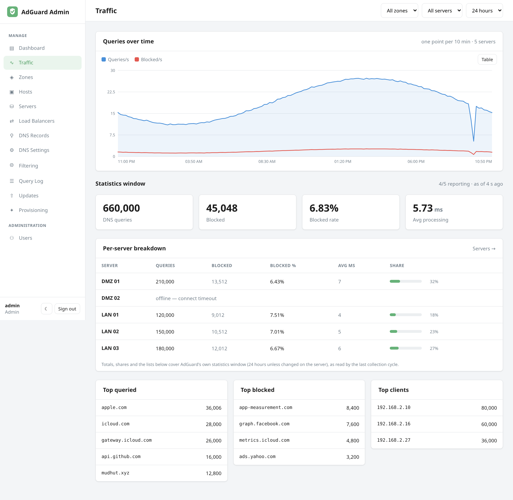
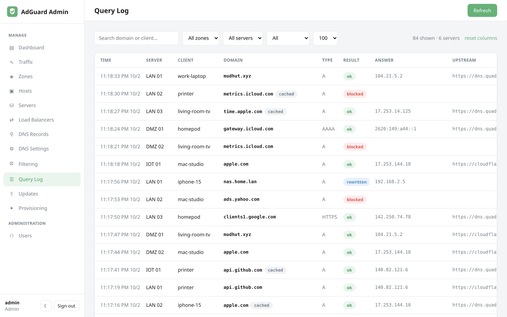

# Dashboard, traffic & query log

Three views give you fleet-wide visibility without logging into each server.
The Dashboard and Traffic pages read the control plane's own
[sample store](observability.md), so they load instantly and show history;
the query log is fetched live.

## Dashboard

The **Dashboard** is the health view.

- **Needs attention** comes first: everything currently wrong, worst first,
  each line linking to the page that fixes it. When nothing is wrong it reads
  **All clear**.
- **Fleet tiles**: servers online, servers in sync, hosts online, balancers in
  sync, queries per second right now and the blocked rate over the last day.
- **One card per zone**: its VIP and who holds it, queries per second,
  blocked rate, servers online and (with a balancer) backends up, with links
  to that zone's traffic and balancers.
- **Traffic**: queries and blocked per second across the fleet, for the last
  hour up to 30 days, filterable by zone. Hover for the values at any point,
  or switch to the table view.

**Sync now** triggers an immediate [reconciliation](concepts.md#reconciliation)
pass, which also takes a fresh sample. The page refreshes itself every minute.

## Traffic

The **Traffic** page is the detail behind the Dashboard's curve:

- the same **queries over time** chart, with zone, server and range filters;
- **statistics window** totals: DNS queries, blocked, blocked rate and
  average processing time, as AdGuard itself counts them (24 hours by
  default, configurable on the server);
- a **per-server breakdown** with each server's share, so you can spot an
  outlier or an idle box;
- **top queried**, **top blocked** and **top clients** merged across the
  selected servers.

All of it comes from the last collection cycle; "as of" shows how fresh it is.

## Query log

The **Query Log** is a single, searchable stream merged from every selected server and
sorted by time — so you can answer "who asked for what, where, and was it blocked?"
without hopping between boxes.

Each row shows the **time**, **server**, **client** (a friendly name when AdGuard knows
one, otherwise the IP), **domain**, query **type**, **result** (`blocked` / `ok` /
`rewritten`), **answer**, **upstream**, and processing time. A **cached** badge marks
answers served from AdGuard's cache.

Controls:

- **Search** by domain or client (pushed down to each AdGuard instance).
- Filter by **zone**, **server**, and **result status** (blocked, filtered, allowed,
  rewritten, allowlisted, safe-search).
- Choose how many rows to pull per server (50–500).
- **Resizable columns** — drag a column edge; widths are remembered. **Reset columns**
  restores defaults.

Because the log is fetched live from each server's own query log, it reflects exactly
what AdGuard recorded — the admin app just merges, tags, and sorts it for you.
