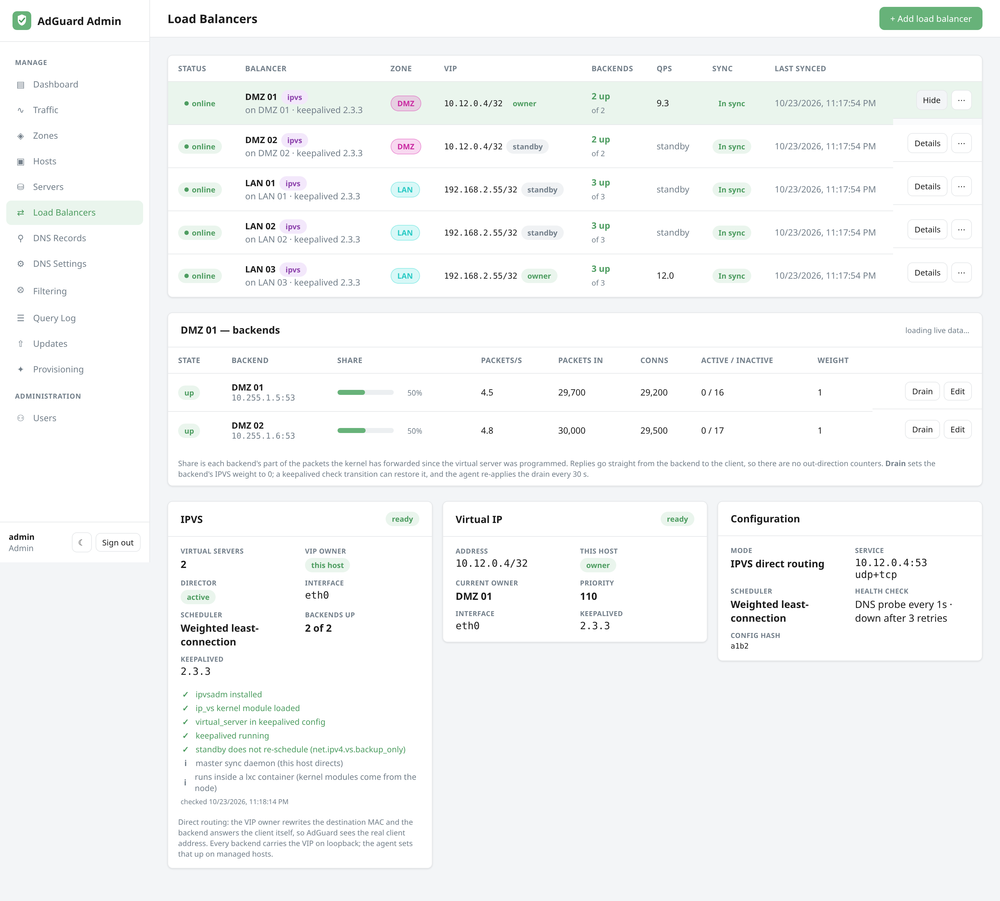

# Load balancing

Clients configured with a primary and a secondary resolver do not spread load:
most stacks send everything to the first entry and only fall over on timeout.
AdGuard Admin fixes that with a **balancer per zone**, declared here and
converged on the host by the [agent](hosts.md), plus a **virtual IP** per zone
floated between balancers with **keepalived**.

There are two balancing modes. Every balancer in a zone uses the same one.

| | **dnsdist** (default) | **IPVS direct routing** |
|---|---|---|
| What runs on the balancer host | dnsdist, a DNS proxy, plus keepalived for the VIP | keepalived only: it owns the VIP *and* programs the kernel's IPVS table |
| Where backends can be | Anywhere reachable over IP: other VLANs, cloud boxes | On the **same Layer 2 segment** as the VIP (direct routing rewrites the destination MAC) |
| What AdGuard sees as the client | The balancer's address (the real client's subnet rides along as ECS, see below) | The **real client address**: query log, client names and per-client rules work |
| Statistics per backend | Queries, QPS, latency, outstanding, drop rate, health-check failures | Connections, packets in, packets/s in (replies bypass the director) |
| Policies | leastOutstanding, roundrobin, wrandom, whashed, firstAvailable | rr, wrr, lc, wlc, sh (source hash pins a client to one backend) |
| Optional cache | Yes (off by default) | No |
| VIP | Optional | Required: the VIP is the virtual service |
| AdGuard on a balancer host | Moved to loopback:5335, dnsdist owns :53 | Stays on :53 on every backend, directors included |

Pick **dnsdist** when a zone spans routers or you want per-query insight. Pick
**IPVS** when a zone is one flat segment and client identity in AdGuard matters.
Switching a zone's mode later is a normal edit: the agents stand the old role
down and bring the new one up on the next cycle.


## The shape (dnsdist mode)

```
             clients -> 10.0.0.53  (zone VIP, VRRP)
                             |
        +--------------------+--------------------+
        |                    |                    |
  host A (agent)       host B (agent)       host C (agent)
  dnsdist :53          dnsdist :53          dnsdist :53
  keepalived prio 150  keepalived prio 100  keepalived prio 50
  AdGuard 127.0.0.1:5335  AdGuard 127.0.0.1:5335  AdGuard 127.0.0.1:5335
        \________ backends: every AdGuard server in the zone ________/
```

The recommended layout is **every zone server runs both roles**: provision each
host with *AdGuard Home* and *dnsdist balancer* ticked. Whichever host holds the
VIP balances across all the zone's AdGuard instances, including those on the
other hosts; if it dies, VRRP moves the VIP within about a second and the next
host's dnsdist takes over with the same backend list. No extra machines.

Dedicated balancer hosts work too: provision them with only the *dnsdist* role.



## The shape (IPVS direct-routing mode)

```
             clients -> 10.0.0.53  (zone VIP, VRRP)
                             |
        +--------------------+--------------------+
        |                    |                    |
  host A (director)    host B (backup)      host C (backup)
  keepalived + IPVS    keepalived + IPVS    keepalived + IPVS
  VIP on eth0          VIP on lo            VIP on lo
  AdGuard :53          AdGuard :53          AdGuard :53
        \__ the VIP owner rewrites each packet's destination MAC to a backend;
            the backend answers the client directly, from the VIP __/
```

The same hosts, the same keepalived; the difference is what the VIP owner does
with a packet. It never terminates the query, so the backend sees the client's
own address and replies straight back. Every backend, directors included,
holds the VIP on its loopback with ARP suppressed so it accepts the packet
without answering ARP for it; the agent configures that (the `ipvs_backend`
role) on every agent-managed server in the zone. A server added by URL in an
IPVS zone needs the same by hand:

```bash
ip addr add 10.0.0.53/32 dev lo
sysctl -w net.ipv4.conf.all.arp_ignore=1 net.ipv4.conf.all.arp_announce=2 \
          net.ipv4.conf.lo.arp_ignore=1  net.ipv4.conf.lo.arp_announce=2
```

Health checks run from the director with the agent's own DNS probe; a failed
backend stays in the table at weight 0, which is what the page shows as
**down**. Because replies bypass the director, only inbound counters exist.

## What is derived, what you set

**Derived (you never type it):**

- **Backends** = the enabled AdGuard servers in the balancer's zone. Adding a
  server to the zone adds it to every balancer in the zone on the next pass.
- **Addresses and ports.** An AdGuard instance that shares a host with a
  balancer is moved to **127.0.0.1:5335** (the balancer owns :53); other
  servers are reached on their host's address and DNS port. Servers added by
  URL are reached at the URL's host and their *DNS port* setting.
- **Backend names** (`<server>-<id>`), the dnsdist API key and console key, the
  VRRP router id and password.

**Set per zone (Zones page):** the **VIP** in CIDR form (`10.0.0.53/24`) and,
optionally, the **VRRP router id** (1-255). Removing the VIP tells every
balancer in the zone to stand down keepalived.

**Set per balancer (Load balancers page):**

| Setting | Default | Notes |
|---|---|---|
| Mode | `dnsdist` | `dnsdist` or `ipvs`. One mode per zone. |
| Scheduler (IPVS) | `wlc` | `rr`, `wrr`, `lc`, `wlc`, `sh`. The health check reuses the interval and retry settings below. |
| Listen addresses (dnsdist) | `0.0.0.0:53` | One per line; IPv6 as `[::]:53`. |
| Policy | `leastOutstanding` | Also `roundrobin`, `wrandom` (weights), `whashed`, `firstAvailable` (order). |
| ECS | on | Forward the client's address as EDNS Client Subnet. See the caveat below. |
| Cache | off | dnsdist packet cache. Off because AdGuard already caches and a front cache undercounts AdGuard's statistics. |
| Health check | `a.root-servers.net.` every 1 s, down after 3 failures, up after 2 | Mode `auto` or `lazy`. |
| ACL | RFC 1918, loopback, ULA, link-local | Who may query the balancer. |
| VRRP priority / interface | 100 / auto | Higher priority owns the VIP. Interface defaults to the one carrying the agent's address. |
| Install method / image | Docker, `powerdns/dnsdist-20:2.0.8` | Bare-metal uses the distro package. |

**Per backend:** enabled, weight, order (via the detail panel), and **drain**,
which takes a backend out of rotation immediately without changing the config
(dnsdist marks it administratively down; undrain returns it to health-checked
state). Drains survive a dnsdist restart.

## What the page shows

The table gives each balancer's status, host, dnsdist version, VIP and whether
this host currently **owns** it, backends up/down/drained, total QPS and sync
state. Select a row for the detail panel, refreshed from the host every 5 s:

- **Backends** with state, QPS, queries, a **share bar** (that backend's part of
  the balancer's total, the direct answer to "is it balanced"), latency,
  outstanding queries, drop rate, weight and order.
- **dnsdist statistics**: queries, responses, SERVFAILs, downstream timeouts and
  send errors, cache hits and misses, latency averages, memory and CPU.
- **Frontends** (listeners) and their counters.
- **VRRP** state when the zone has a VIP.

The Servers page shows the balancers' view of each server (up, down, drained,
QPS) next to the control plane's own view, so "dnsdist marked this server down"
is visible without opening the balancer.

## How it converges

Each reconcile cycle renders the balancer's desired state, hashes it, and pushes
it to the host only when the hash differs from the one the agent reports. The
agent writes dnsdist's configuration, validates it with `dnsdist --check-config`,
and restarts dnsdist (sub-second; clients retry). The balancer is **in sync**
when the agent's applied hash equals the desired one and dnsdist reports ready.
Balancers are reconciled after servers, so a server that just came online is in
the pool in the same cycle.

## Caveat: client identity behind a dnsdist balancer

AdGuard Home identifies clients by the **source address** of the query. Behind
dnsdist that is the balancer's address, so in AdGuard's own query log and
per-client settings every proxied query looks like it came from the balancer.
With **ECS** on, dnsdist adds the real client's subnet to each query and AdGuard
shows it in the query log's request details and forwards it upstream, but
AdGuard does **not** use it to identify clients. If you rely on AdGuard
per-client rules, use **IPVS mode** for that zone, keep those clients pointed at
an AdGuard server directly, or put the rules in blocklists that apply to
everyone.

## Requirements and ports

- A dnsdist balancer host needs **53/udp and 53/tcp** free (the agent moves a
  co-located AdGuard to loopback:5335 automatically). An IPVS director needs
  the `ip_vs` kernel module (loaded by the agent; present in stock Debian,
  Ubuntu and Fedora kernels). Any VIP needs **VRRP (IP protocol 112)** between
  the zone's hosts, sent as unicast to the other balancers' addresses.
- In IPVS mode the director and every backend must share a Layer 2 segment;
  clients may be anywhere routed to the VIP.
- **Containers (Proxmox LXC and similar).** A container cannot load kernel
  modules, so load IPVS on the node that runs it, once, and it is visible to
  every container there:

  ```bash
  modprobe ip_vs ip_vs_wlc ip_vs_rr ip_vs_wrr ip_vs_lc ip_vs_sh
  printf 'ip_vs\nip_vs_wlc\nip_vs_rr\nip_vs_wrr\nip_vs_lc\nip_vs_sh\n' > /etc/modules-load.d/ipvs.conf
  ```

  Then restart keepalived in the container. Until then the balancer shows
  "No virtual server programmed" with that exact hint, VRRP still works, and
  queries to the VIP are answered by the VIP owner's own AdGuard alone, so
  nothing is balanced yet. The loopback VIP and ARP settings are per network
  namespace and need nothing on the node.
- **AdGuard runs on the host network.** The agent starts the AdGuard container
  with `--network host` rather than published ports, because Docker implements
  a published port as a DNAT rule in PREROUTING: on an IPVS director that
  rewrite happens before IPVS sees the packet, so every query to the VIP would
  be answered by the director's own AdGuard and nothing would be balanced.
  Host networking also drops the userland proxy that loopback-published ports
  need. AdGuard's listen addresses are managed in its configuration file
  instead, exactly as on a native install.
- **Only the VIP owner directs; standbys are plain backends.** Every
  director holds the same IPVS table, so a standby would otherwise
  re-schedule the packets the owner direct-routes to it, and the two kernels
  would bounce each query between them until its TTL ran out (with three
  directors about half of all queries timed out, and phones that give up on a
  resolver after a few timeouts lost DNS for a minute at a time). The agent
  therefore adds `lvs_sync_daemon` to the keepalived config, which runs the
  IPVS master sync daemon on the owner and the backup daemon on each standby,
  and sets `net.ipv4.vs.backup_only=1` (persisted in
  `/etc/sysctl.d/91-adguard-admin-ipvs-director.conf`): while the backup
  daemon runs the kernel skips IPVS and hands VIP packets to the local
  AdGuard. The balancer detail shows **Director: active** on the owner and
  **standby** elsewhere, the standby's row shows "standby" in place of a QPS,
  and the Dashboard's VIP tile reads the owner's counters. The sync daemon
  uses multicast 224.0.0.81 port 8848 on the VIP interface; it only needs to
  *run* for the standby to stand down, so a bridge that drops multicast
  costs connection sync on failover, nothing more.
- **Unprivileged containers cannot be IPVS directors.** Writing the IPVS
  table needs `CAP_NET_ADMIN` in the host's own namespace, which an
  unprivileged container's root never has; keepalived logs
  `IPVS cmd IP_VS_SO_SET_ADD ... Permission denied (you must be root)` on every
  call and the balancer shows exactly that. Run the balancer role on a
  privileged container or a VM. Backends only need the loopback VIP and the
  ARP sysctls, which work unprivileged, so two privileged directors plus
  unprivileged AdGuard hosts is a sound layout. dnsdist mode has no such
  requirement.
- The VIP must be in a subnet the hosts share; it is held by one host at a
  time and must not be handed out by DHCP.
- dnsdist and keepalived are installed by the agent: dnsdist as the official
  container (host networking, bound to :53 with the minimum capabilities) or the
  distro package; keepalived as the distro package.
