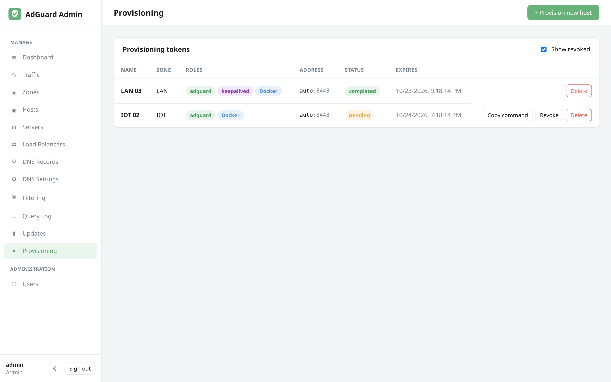

# Provisioning

Provisioning turns a fresh Linux box into a **managed host**: one copy-paste
command installs the **host agent**, the agent enrolls with the control plane,
and from then on this app installs, configures and keeps converged whatever
roles you asked the host to run — **AdGuard Home**, a **dnsdist load balancer**,
or both. No manual setup wizard, no copying credentials around, nothing typed on
the box.



## How it works

1. On the **Provisioning** page, click **+ Provision new host** and choose:
   - **Name** and **zone**.
   - **Roles** — *AdGuard Home* and/or *dnsdist balancer*. A balancer needs a
     zone: its backends are the zone's AdGuard servers. See
     [Load balancing](load-balancing.md).
   - **AdGuard install method** — `Docker` or `bare-metal` (native install).
   - **Connect address** (optional) — the IP or FQDN this app will use to reach
     the agent. Leave empty to use the address the agent reports, which is the
     one it uses to reach this app.
   - **Agent port** (default 8443), **prune**, **auto-update**, **expose web UI**
     (publish AdGuard's own UI on the LAN instead of keeping it behind the
     agent), and, for a balancer in a zone with a VIP, the **VRRP priority**.
2. The app issues a **provisioning token** and shows a one-line command:

   ```bash
   curl -fsSL "https://<your-admin-url>/api/provision/<token>/install.sh" | sudo bash
   ```

3. Run that command as root on the target machine. The script:
   - downloads the agent binary for the machine's architecture and verifies its
     SHA-256 against the manifest the control plane publishes,
   - runs `adguard-admin-agent enroll`: the agent generates a private key **on the
     box**, sends a certificate signing request to the control plane, and
     receives its certificate and the CA certificate,
   - installs a systemd service and starts the agent.
4. The token flips from **pending** to **completed**. A **host** appears on the
   [Hosts](hosts.md) page, plus a **server** and/or a **load balancer** for the
   roles you picked. Within a few seconds the control plane pushes each role's
   desired state and the host converges: the server shows **provisioning** while
   AdGuard is being installed, then **online** once it answers, and the
   reconciliation engine starts pushing your records and settings to it.

Nothing else is fetched or executed from a token URL. The AdGuard admin password
the control plane generated for the host travels only inside the mutual-TLS
channel to the agent, and the private key never leaves the box.

## Tokens

- Tokens are **single-use** and **expire** after `PROVISION_TOKEN_TTL_HOURS`
  (default 24). Enrollment consumes the token in the same transaction that
  issues the certificate, so a replayed (log-visible) URL gets `409` and no
  certificate.
- **Revoke** a token any time before it's used; revoked and expired tokens are
  rejected by both `install.sh` and `/enroll`.
- Toggle **Show revoked** to include inactive tokens in the list.

### Input validation

The host **name** is interpolated into a comment of the generated script, and the
**connect address** into both the script and the agent's URL and certificate, so
they are validated on entry (no control characters; addresses must be a plain
hostname or IP) and shell-quoted on output. The address the agent reports at
enrollment is validated the same way.

## Requirements

- **`PUBLIC_BASE_URL` must be reachable by the new host** and should be HTTPS.
  The install command, the binary download and the enrollment request are built
  from it. Over plain HTTP the token and the issued certificate are readable on
  the wire; the script and the agent both warn about it.
- The target machine needs **systemd**, outbound access to the admin app, and,
  for Docker roles, a working Docker runtime (the agent installs Docker if it is
  missing). Supported architectures: `amd64`, `arm64`, `arm` (armv7).
- The control plane must reach the agent on its port (default **8443/tcp**).

## Servers added by URL

Hosts without an agent still work: **Servers → + Add server** with a URL and
credentials, as before. They are reconciled directly over AdGuard's API and
cannot be load-balanced from this app unless a balancer in their zone can reach
their DNS port.
